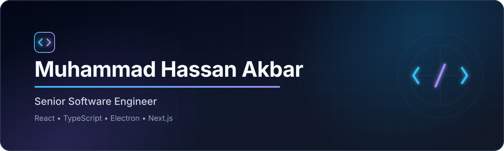

  

   

  
  
  

## Hey, I'm Hassan 👋

I'm a senior software engineer who builds and ships cross-platform products—from polished React interfaces and offline-first Electron apps to multi-tenant platforms and AI-assisted workflows.

Over the last **3+ years**, I've worked across the full product lifecycle: architecture, implementation, security, performance, release automation, observability, and production delivery. I care about turning complicated systems into dependable experiences that feel simple to the people using them.

## What I bring to the table

| Product engineering | Platform & delivery | Architecture & reliability |
| :--- | :--- | :--- |
| React, Next.js, Electron | GitHub Actions, Docker, Vercel | Offline-first desktop apps |
| AI-assisted creation flows | Code signing & automated releases | Multi-tenant systems |
| Cross-platform experiences | AWS, GCP, S3 | Secure API & asset delivery |

Some outcomes I'm proud of:

- Cut customer load times by **up to 90%** by moving expensive client-side work into asynchronous backend queues.
- Migrated **180 book templates** while redesigning an AI-assisted children's book creation engine across desktop and web.
- Modernized roughly **90% of a legacy React-on-Rails frontend**, replacing class components with functional components and hooks.
- Replaced exposed cloud credentials with presigned S3 uploads and built reliable signed release pipelines for Electron applications.
- Designed multi-tenant storefront and database strategies that safely preserved customer-specific behavior while sharing platform improvements.

## Featured build

<table>
  <tr>
    <td width="68%" valign="top">
      <h3><a href="https://github.com/mhassanakbar/dev-mux">DevMux</a></h3>
      
A GUI-first, cross-platform alternative to tmux for local development environments. Group an app, API, workers, databases, and supporting processes into one persistent workspace—then start, stop, monitor, and search them without juggling terminals.

      
<strong>Electron 44 · React 19 · TypeScript · Vite · Zustand · Tailwind CSS</strong>

    </td>
    <td width="32%" valign="top">
      <strong>Built for real workflows</strong>  
      ✓ Typed, isolated IPC 
      ✓ Process supervision 
      ✓ Unified searchable logs 
      ✓ Persistent workspaces 
      ✓ Windows, macOS & Linux
    </td>
  </tr>
</table>

  

## Toolbox

**Languages** 

**Frontend & desktop** 

**Backend & data** 

**Cloud, AI & delivery** 

## A little more about me

- 💼 Previously built product and platform systems at **Alphasquad** and **Arkhitech**.
- 🎓 B.S. in Computer Science from **FAST National University**, Islamabad.
- 🧭 Especially interested in desktop tooling, AI-native product experiences, and systems that keep working when connectivity doesn't.
- 🤝 Open to thoughtful conversations about product engineering, Electron architecture, React, and TypeScript.

   
  <strong>Have an interesting problem to solve?</strong> 
  <a href="mailto:mhassanakbar@outlook.com">Let's build something useful.</a>

